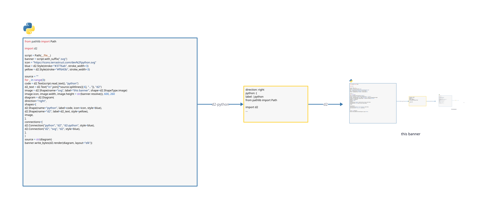

# d2-python



d2-python is a typed Python library for building [D2](https://d2lang.com) diagrams. You describe shapes and connections as Python objects, and the library writes D2 text that you can render to SVG, PNG, PDF or ASCII. The banner above is drawn by [docs/banner.py](docs/banner.py).

This project is a maintained hard fork of [MrBlenny/py-d2](https://github.com/MrBlenny/py-d2), which has not been updated since 2024. See [Coming from py-d2](#coming-from-py-d2) if you used it.

## Install

```bash
pip install d2-python
```

To render diagrams from Python, also install the official d2 binary with the `bin` extra:

```bash
pip install 'd2-python[bin]'
uv add 'd2-python[bin]'
```

If you already have the `d2` command on your PATH, you do not need the extra. The binary is published on its own as [`d2-bin`](packages/d2-bin), so `uvx d2-bin` runs D2 without installing anything.

## Quick start

```python
import d2

diagram = d2.Diagram(
    shapes=[
        d2.Shape(name="api", label="API"),
        d2.Shape(name="db", label="Postgres", shape=d2.ShapeType.cylinder),
    ],
    connections=[d2.Connection("api", "db", "reads and writes")],
)

print(diagram)                            # the D2 text
open("graph.svg", "wb").write(d2.render(diagram))
print(d2.render(diagram, "txt").decode())  # ASCII art
```

`print(diagram)` prints this D2 text:

```d2
api: API
db: Postgres {
  shape: cylinder
}
api -> db: reads and writes
```

The ASCII render looks like this:

```text
    ┌──────┐
    │ API  │
    │      │
    └──────┘
        │
reads and writes
        │
        ▼
    .-‾‾‾‾-.
   │╲-____-╱│
   │        │
   │Postgres│
   │        │
    ╲-____-╱
```

## Building diagrams

Every feature below has a runnable script in [examples/](examples/README.md).

Shapes take a type, an icon, a tooltip and a link:

```python
db = d2.Shape(
    name="db",
    shape=d2.ShapeType.cylinder,
    icon="https://icons.terrastruct.com/essentials%2F117-database.svg",
    tooltip="Primary database",
    link="https://example.com/runbook",
)
```

A shape can hold other shapes. Connect nested shapes with a dotted path:

```python
backend = d2.Shape(name="backend", shapes=[d2.Shape(name="api"), d2.Shape(name="worker")])
d2.Connection("backend.api", "backend.worker")
```

Styles set colors, borders, fonts and effects:

```python
d2.Style(fill="#dbeafe", stroke="navy", stroke_width=2, bold=True, shadow=True)
```

Connections take a direction, a label, a style and arrowheads, including crow's foot ends for data models:

```python
d2.Connection(
    "orders",
    "users",
    "belongs to",
    direction=d2.Direction.TO,
    style=d2.Style(stroke="gray", animated=True),
    source_arrowhead=d2.Arrowhead(d2.ArrowheadShape.CF_MANY),
    target_arrowhead=d2.Arrowhead(d2.ArrowheadShape.CF_ONE_REQUIRED),
)
```

A label can be Markdown, LaTeX or code:

```python
d2.Shape(name="notes", label=d2.Text("# Notes\nSome **bold** text", "md"))
```

Other features:

- SQL tables with constraints, and UML class shapes with fields and methods.
- Grids, with `grid_rows`, `grid_columns` and gaps.
- Reusable style classes, set on the diagram and used by name.
- Layers, scenarios and steps, which are extra boards in one diagram.
- Diagram settings through `d2.Config`, such as the layout engine, theme and sketch mode.
- Variables with `${name}` substitution, and legends.
- Label and icon positions, and fixed `top` and `left` positions.
- Comments at the top of the file.

## Rendering

`d2.render(diagram, format)` runs d2 and returns the result as bytes. It uses the binary from `d2-bin` when that is installed, and otherwise the `d2` command on your PATH. You can also pass D2 text as a string.

| Option | Values |
|---|---|
| `format` | `"svg"` (default), `"png"`, `"pdf"`, `"gif"`, `"pptx"` or `"txt"` for ASCII |
| `layout` | `"dagre"`, `"elk"` or `"tala"` |
| `theme`, `dark_theme` | a D2 theme id |
| `target` | the board to render: the root by default, or a path such as `"layers.detail"` |
| Others | `sketch`, `pad`, `scale`, `center`, `omit_version`, `no_xml_tag`, `salt`, `animate_interval`, `ascii_mode`, `timeout` |

If d2 fails, `render` raises `d2.D2Error` with d2's message.

## Checking and formatting D2

`d2.validate` runs `d2 validate` and raises `d2.D2Error` when the source is wrong. `d2.fmt` returns the source formatted by `d2 fmt`. Both take a `Diagram` or a string, so you can use them to check D2 text that a person or a language model wrote.

```python
d2.validate("a -> b")
print(d2.fmt("a->b"))
```

`validate` checks the syntax and meaning of the source. It does not lay the diagram out, so a few errors only show when you render.

## How values are checked

The library checks values when you create an object, so a mistake fails in your code instead of in d2.

- Names and labels that D2 cannot read as written are quoted for you, e.g. a name with a dot or a D2 keyword such as `shape`. Connection endpoints are written as given, so they can be dotted paths.
- A color can be a CSS color name, a 3 or 6 digit hex code with or without `#`, a gradient or a `${variable}`. You can pass a string or a `d2.Color`. The library writes hex codes in lowercase with `#` and in quotes, because a bare `#` starts a comment in D2. Any other value raises `ValueError`.
- Numbers that D2 limits are checked, e.g. `opacity` must be from 0 to 1.

## Coming from py-d2

Import `d2` instead of `py_d2`, and drop the `D2` prefix from class names, e.g. `d2.Shape` instead of `py_d2.D2Shape`. The pull requests that were open on py-d2 are merged here, and most of its open issues are fixed. Issues and pull requests are welcome on this repository.

## Development

You need [uv](https://docs.astral.sh/uv/).

```bash
git clone git@github.com:h0rv/d2-python.git && cd d2-python
uv sync --extra bin

uv run pytest
uv run ruff check
uv run ruff format
uv run ty check
```

To redraw the banner, run `uv run python docs/banner.py`.

## License

d2-python is MIT licensed. The `d2-bin` package contains the unmodified D2 binary, which is licensed under the MPL-2.0 by Terrastruct.
